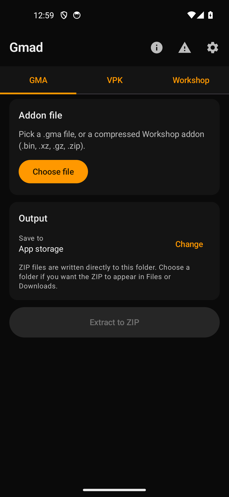
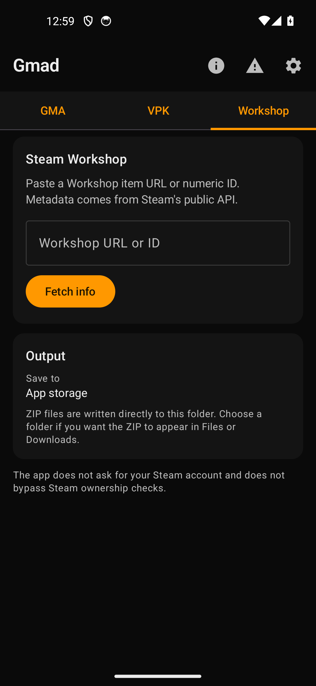
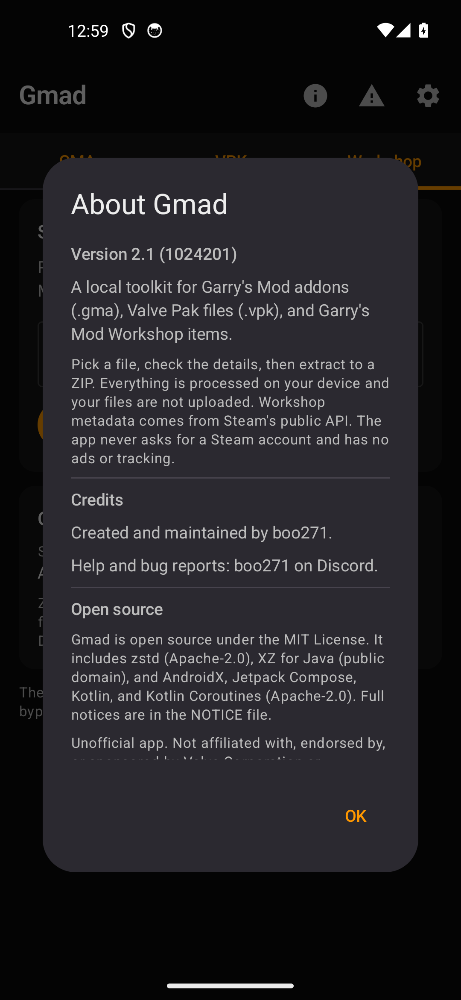

# Gmad

Gmad extracts Garry's Mod addons (`.gma`) and Valve Pak files (`.vpk`) on Android, and it can download Garry's Mod Workshop items without a Steam account.

The project started in October 2025 as a Python/Kivy app. This repository now contains the native Kotlin/Jetpack Compose rewrite, version 2.1.

## Screenshots

| GMA | Workshop | About |
| --- | --- | --- |
|  |  |  |

## What it does

- Opens `.gma` files, shows the addon name, author, and size, and extracts them to a ZIP.
- Reads VPK v1 and v2, including multi-part `_dir.vpk` sets.
- Handles `.bin` (LZMA), `.xz`, `.gz`, and `.zip` wrapped addons.
- Downloads Workshop items through Steam's public content network the same way SteamCMD does, without an account. Items Steam refuses to serve anonymously are refused by the app too.
- Shows which Steam app an item belongs to and whether anonymous downloads work for that app.
- Processes everything on the device. No analytics, no ads, no account login, and no upload of your files.

## Supported Workshop apps

Measured against Steam without an account:

| App ID | Game | Anonymous download |
| --- | --- | --- |
| 4000 | Garry's Mod | Yes |
| 440 | Team Fortress 2 | Yes |
| 480 | Half-Life: Source | Yes |
| 570 | Dota 2 | Yes |
| 730 | Counter-Strike 2 | Yes |
| 105600 | Terraria | Yes |
| 252490 | Rust | Yes |
| 220 | Half-Life 2 | No, Steam requires ownership |
| 320 | Half-Life 2: Deathmatch | No |
| 340 | Half-Life 2: Lost Coast | No |
| 420 | Half-Life 2: Episode Two | No |
| 550 | Left 4 Dead 2 | No |
| 620 | Portal 2 | No |
| 107410 | Arma 3 | No |
| 243750 | Half-Life 2: Update | No |
| 244310 | Source SDK Base 2013 Dedicated Server | No |

Unlisted apps are untested. The app will try them and report what Steam says.

## Install

Download the APK from the Releases page and open it. Android 7.0 (API 24) or newer is required. The app asks for no permissions except internet access, and files are chosen through the system file picker.

If Gmad 2.0 or earlier is installed, uninstall it once before installing 2.1. Those versions used an earlier signing key, so Android cannot update them in place. The 2.1 APK is signed with the current release key, and every later 2.1+ update installs normally over it.

## Build

Requirements: JDK 17 or 21 (the Kotlin version used here does not support JDK 25 or newer) and Android SDK 35.

```
./gradlew assembleDebug
./gradlew assembleRelease
```

When `keystore.properties` is present, release builds are signed automatically with the local key. Otherwise the release output is unsigned.

Tests:

```
./gradlew testDebugUnitTest
./gradlew testDebugUnitTest -Pgmad.live=1
```

`-Pgmad.live=1` also runs one real Workshop download.

## Release signing

Release builds use a local signing key. Neither the key nor its passwords are in the repository.

- The key is kept outside the repository at `keystore/gmad-release.p12`; keep a secure offline backup. If it is lost, installed copies can no longer be updated.
- `keystore.properties` holds the local passwords and is ignored by git.
- The first release signed with this key must be installed fresh. Later APKs signed with the same key and a higher `versionCode` install as normal updates.
- Increase `versionCode` in `app/build.gradle.kts` for every public release.

Do not commit, upload, or share the key or `keystore.properties`.

## Privacy

Gmad does not collect, store, or send personal data. There is no login, no telemetry, no advertising ID, and no crash reporting. Files you open stay on your device. The only network requests are Steam's public endpoints, an optional Workshop resolver you configure yourself, and a check of GitHub's public Releases API for new versions at most once a day. Update checks send no personal data, and automatic checks can be turned off in Settings; a manual "Check now" button stays available.

## Legal

Gmad is an unofficial tool. It is not affiliated with, endorsed by, or sponsored by Valve Corporation or Facepunch Studios. "Gmad" here refers to this Android app, not the gmad tool bundled with Valve's Garry's Mod SDK. Steam, Garry's Mod, and Valve are trademarks of Valve Corporation. Addon content remains the property of its creators; respect their licenses when you redistribute anything you extract.

The app's own code is released under the MIT License (see [LICENSE](LICENSE)). Third-party components remain under their own licenses; see [NOTICE](NOTICE). This keeps the app compatible with the Apache-2.0 dependencies it includes.

The Workshop downloader only uses content Steam serves to an anonymous session, the same way SteamCMD does. It does not bypass ownership checks, DRM, or paid content, and it does not ask for Steam credentials.

The software is provided as is, without warranty. See [LICENSE](LICENSE).

## Contact

Bug reports and contact: **boo271** on Discord.

## Credits

boo271.

Open-source components are listed in [NOTICE](NOTICE).
